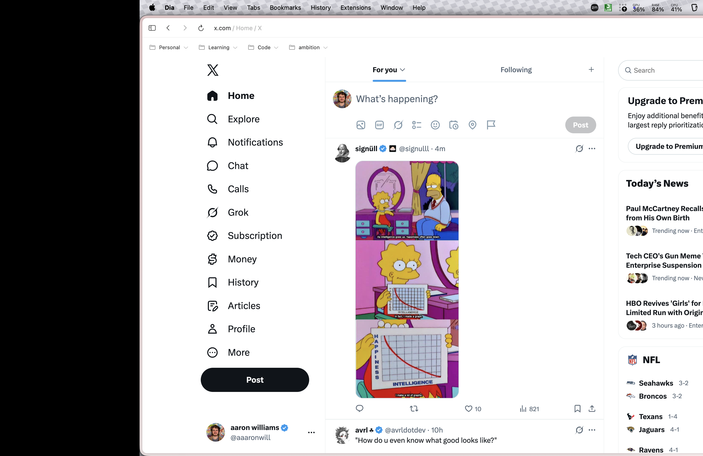
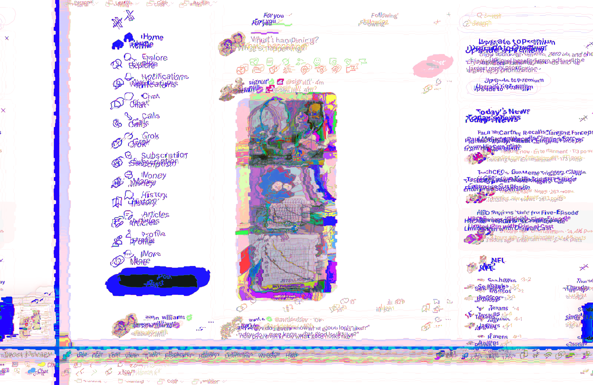

# PrankVirus

A macOS prank with two effects, each on its own hotkey. Use it on your own Mac
or with the owner's agreement.

| Hotkey | Effect |
|---|---|
| **Control + Option + Command + G** | Glitch: the screen shakes, splits into red/green/blue copies and its colours scramble |
| **Control + Option + Command + S** | Shift: the whole screen, menu bar and Dock included, slides 300 points right |

- Press the same hotkey again to turn an effect off; the other hotkey swaps effects.
- Effects stay on until toggled off, unless started with a timeout (see below).
- No permission prompts: no Screen Recording, no Accessibility.
- No menu bar icon or Dock tile: nothing on screen shows it is running.
- Mouse clicks still land where the real windows are, not where they appear.

## Screenshots

**Shift** (Control + Option + Command + S): the whole screen slides right and
the uncovered strip on the left goes black.



**Glitch** (Control + Option + Command + G): the screen jitters, splits into
colour copies and its colours scramble.



## Install

```bash
brew install aaronw122/tap/prankvirus
prankvirus check
prankvirus start
```

`prankvirus check` asks you to press each hotkey and confirms the press reaches
PrankVirus on this Mac. It also flags a clashing macOS system shortcut. A key
remapper such as Karabiner-Elements or BetterTouchTool can intercept a hotkey;
the check catches that too. Another app using the same combination does not
block PrankVirus, but that app's action would also run.

`prankvirus start` runs it in the background, with nothing left in the
terminal, and starts it again at every login. Effects stay on until their
hotkey is pressed again. To have each effect turn itself off, give a number of
minutes:

```bash
prankvirus start -30
```

Running `prankvirus start` again replaces the setting. To stop it now and at login:

```bash
prankvirus stop
```

To remove it:

```bash
prankvirus stop
brew uninstall prankvirus
```

## Build from source

Requires macOS 14 or later and a Swift toolchain (the Command Line Tools are enough).

```bash
swift build -c release
.build/release/prankvirus
```

`kill -USR1 <pid>` toggles the glitch and `kill -USR2 <pid>` the shift.

## How it works

Each effect is a borderless window above the menu bar holding private
`CABackdropLayer`s, the layer `NSVisualEffectView` is built on. WindowServer
samples everything behind the window and runs it through private Core Animation
filters, so the screen's pixels never reach this process and macOS does not ask
for Screen Recording.

- **Shift:** one `displacementMap` filter with a constant offset.
- **Glitch:** a port of `reference/03-shaky.metal`. A GPU-generated jitter map
  drives `displacementMap`, `chromaticAberration` splits the colour channels,
  and a 256³ lookup table applies the shader's hue remap. Four masked layers
  rebuild the shader's wrap-around at the screen edges.

The glitch matches the original shader across the screen except at the two
wrap seams (10% in from the left and bottom), where the colour fringes smear
instead of wrapping.

These are private Core Animation APIs. They may change in any macOS release; if
they are missing, the app logs it and does nothing.

## Licence

MIT. See [LICENSE](LICENSE), which also covers the webgl-noise routines in
`reference/common.metal`.
